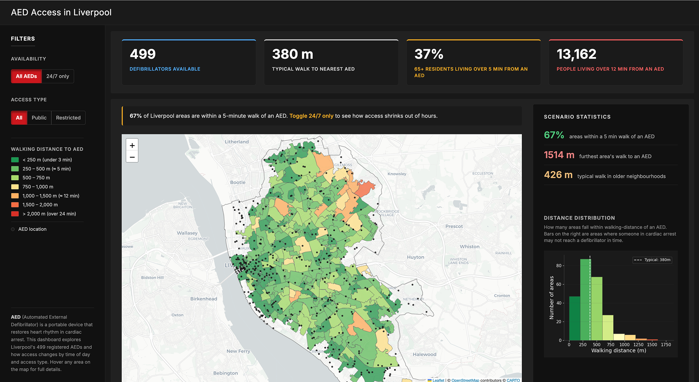

# AED Access in Liverpool

An interactive geospatial dashboard analysing access to public defibrillators (AEDs) 
across Liverpool, and how that access changes by time of day and access type.

## Live dashboard
You can view the live dashboard here: https://maryam-sulayman.github.io/liverpool-aed-access/

## What it shows
Liverpool has good defibrillator coverage on paper, but access drops sharply once you only count defibrillators that are actually usable. Filtering to devices that are available 24/7 and open to the public drops the share of neighbourhoods within a 5-minute walk from 67% to just 8%. Coverage looks good overall but is very uneven out of hours, and older neighbourhoods have the least access.".

Use the filters to explore this yourself, or see the full breakdown in the live dashboard. 

## Data sources
The Circuit (British Heart Foundation national defibrillator registry), ONS 2021 Census and MHCLG Index of Multiple Deprivation (IMD) 2019
All data is publicly available.

Built with Python, Panel, Folium/Leaflet, GeoPandas, OSMnx, NetworkX, matplotlib
